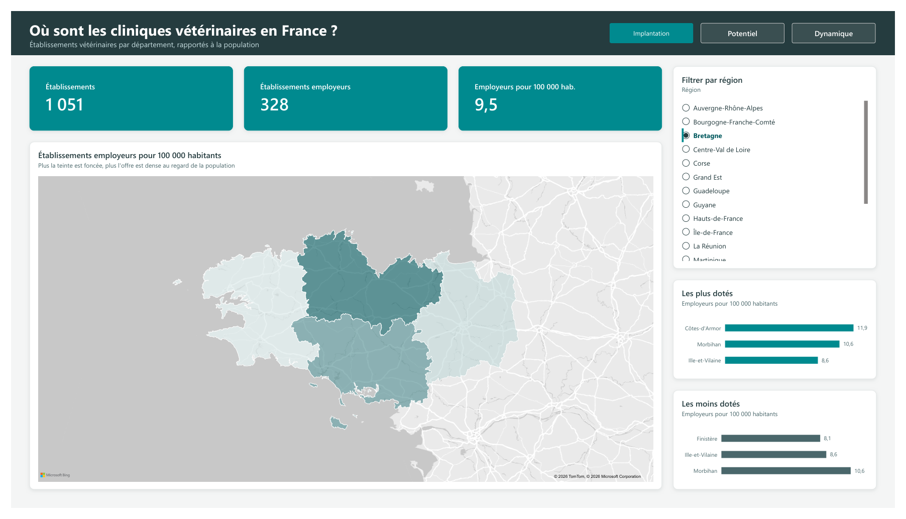
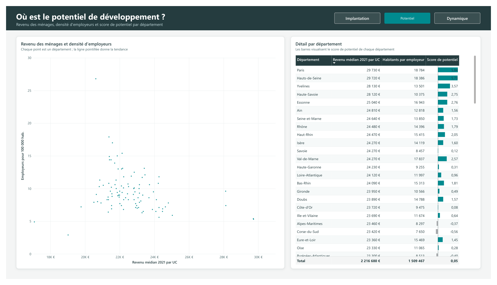
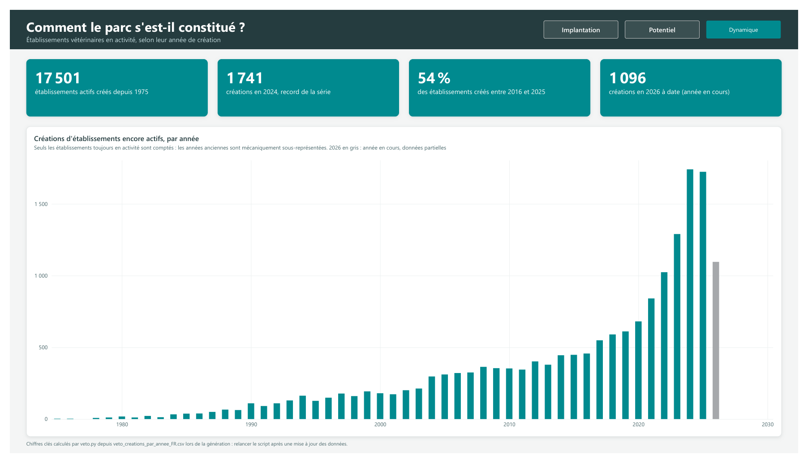

# Cliniques vétérinaires en France : rapport Power BI

Étude de cas sur l'implantation des établissements vétérinaires en France, à partir de données publiques par département.

> Projet personnel, non affilié à Vetoquinol. La charte graphique reprend les couleurs du site public vetoquinol.fr.

**Site de présentation : [seyshea.github.io/powerbi-veterinaire](https://seyshea.github.io/powerbi-veterinaire/)**

Le site présente aussi un second projet, **Démo prédiction** : prévision des ventes et score de risque client, deux modèles Python exécutés dans Power BI sur des données fictives.

## Aperçu







Le rapport complet est aussi disponible en PDF : [rapport_cliniques_France.pdf](documents/rapport_cliniques_France.pdf).

## Ce que montre le rapport

| Page | Question | Contenu |
|---|---|---|
| **Implantation** | Où sont les cliniques vétérinaires ? | Chiffres clés, carte de densité (établissements employeurs pour 100 000 habitants), départements les plus et les moins dotés, filtre par région |
| **Potentiel** | Où est le potentiel de développement ? | Revenu médian et densité d'employeurs par département, tableau détaillé avec score de potentiel |
| **Dynamique** | Comment le parc s'est-il constitué ? | Créations d'établissements encore en activité, par année depuis 1975, et chiffres clés |

## Choix de conception

- **Thème Power BI sur mesure** ([VetoquinolTheme.json](power_bi/VetoquinolTheme.json)) : palette, typographie, cartes, tableaux. Il s'importe dans n'importe quel rapport via *Affichage > Thèmes > Parcourir les thèmes*.
- **Mise en page sur une grille de 12 colonnes**, avec un bandeau de titre et des onglets de navigation entre les pages.
- **Classements dynamiques** des 3 départements les plus et les moins dotés : ils se recalculent selon la région choisie.
- **Année en cours grisée** dans l'histogramme : 2026 est incomplète, et sans ce marquage le graphique suggérerait une baisse qui n'existe pas.
- **Libellés lisibles** à la place des noms techniques des colonnes (« Revenu médian 2021 par UC » plutôt que « Somme de revenu_median_uc_2021 »).
- **Barres de données divergentes** sur le score de potentiel, qui prend des valeurs positives et négatives.

## Contenu du dépôt

```
power_bi/Cliniques_veterinaires_France.pbix   le rapport Power BI
power_bi/VetoquinolTheme.json                 le thème
donnees/cliniques_France/                     les données (CSV)
documents/rapport_cliniques_France.pdf        l'export PDF du rapport
documents/rapport_demo_prediction.pdf        l'export PDF du rapport Démo prédiction
docs/                                         le site de présentation et ses captures
```

## Ouvrir le rapport

Le rapport s'ouvre avec [Power BI Desktop](https://www.microsoft.com/power-platform/products/power-bi/desktop), gratuit sous Windows.

À la première ouverture, Power BI cherche les CSV à leur emplacement d'origine. Pour le corriger : *Transformer les données > Paramètres de la source de données > Changer la source*, puis choisir le dossier `donnees/cliniques_France/` du dépôt.

## Données

Données publiques agrégées pour les 101 départements : nombre d'établissements vétérinaires (total et employeurs), population 2023, superficie, revenu médian 2021, et créations d'établissements par année.
