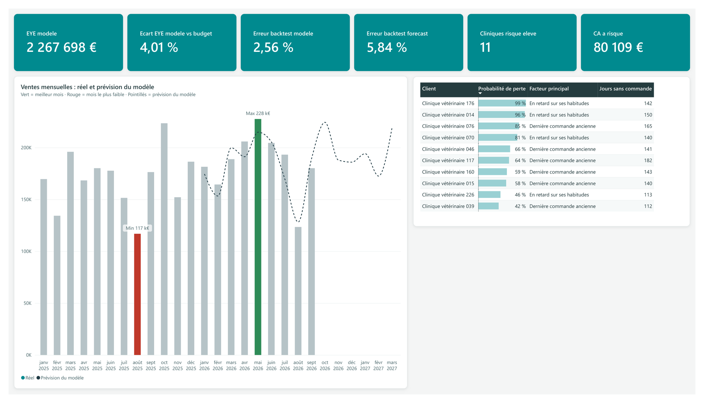

# Portfolio Power BI · Cloé Gueusquin

Data Analyst, Master en statistiques appliquées et analyse décisionnelle.

> Projet personnel

**Site : [seyshea.github.io/powerbi-veterinaire](https://seyshea.github.io/powerbi-veterinaire/)**

Le site réunit mon CV et mes projets Power BI.

## Démo prédiction

Un rapport de ventes vétérinaires sur des données fictives, enrichi de deux modèles statistiques écrits en Python et exécutés dans Power BI :

- **Prévision des ventes** : une régression par produit (tendance et saisonnalité mensuelle), évaluée par un backtest sur janvier–septembre 2026, avec un intervalle de prévision à 80 %.
- **Risque « client perdu »** : une régression logistique qui estime la probabilité qu'une clinique arrête de commander dans les 6 mois. Elle est testée sur une période jamais vue (AUC 0,91).



Le rapport complet est disponible en PDF : [rapport_demo_prediction.pdf](documents/rapport_demo_prediction.pdf).

## Contenu du dépôt

```
docs/                                    le site (accueil, CV, page projet, captures)
documents/rapport_demo_prediction.pdf    l'export PDF du rapport
```

Toutes les données du projet sont fictives.
